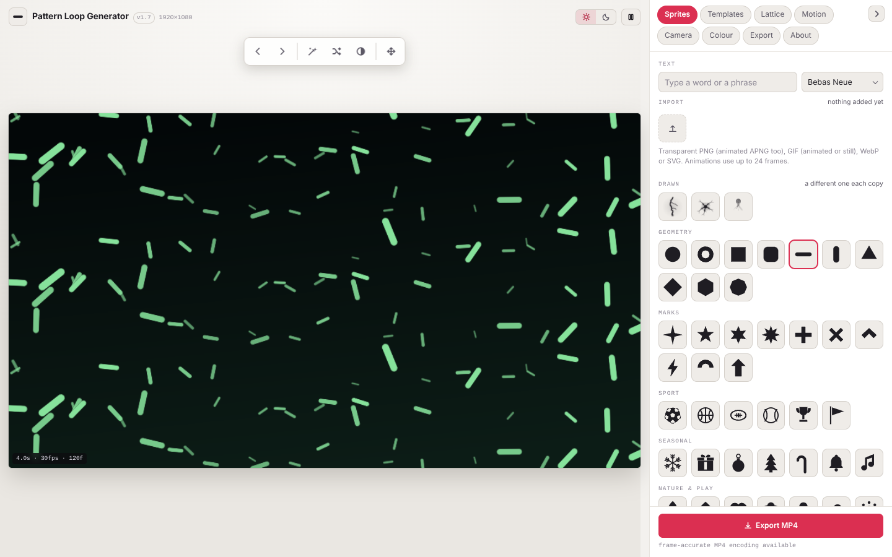

# Pattern Loop Generator
[Launch Pattern Loop Generator](https://dougalder.github.io/pattern-loop-generator/pattern-loop-generator.html)
Make a shape, a word or your own picture repeat across the screen and animate
it in a loop that joins back to its start with no jump. Export the result as a
video (an **MP4** file) or an animated picture (a **GIF** file).



Everything runs in your web browser. Nothing is uploaded, there is no account,
and no tracking. Once the page has loaded it works without an internet
connection.

## Quick start

1. Download this repository, or copy the file `pattern-loop-generator.html`
   to your computer.
2. Double-click `pattern-loop-generator.html`, or open it in Safari, Chrome,
   Edge or Firefox.
3. Pick a template or a shape, then click **Export** at the bottom of the
   controls.

If you are reading this on GitHub, `index.html` is a small start page. When the
repository is published with GitHub Pages it opens the app directly.

## Features

- Built-in shapes, drawn animations (lightning, nerve cells, jellyfish), text
  in several fonts, and your own transparent PNG, GIF, WebP, SVG or animated
  APNG pictures.
- Grid, spiral and tube arrangements, with depth, spin, pulse, lifetimes,
  stepping and a camera that travels a closed circuit.
- More than forty ready-made templates, plus a random-look button.
- Light and dark appearance for the app itself.
- Export to MP4 (H.264 video) or GIF at several sizes up to 4K.
- Save and reopen a complete look as a small `.json` file.
- Works in Safari on Mac, iPhone and iPad, as well as other modern browsers.

## Documentation

- **[User manual](docs/MANUAL.md)**: a full, plain-language guide to every tab
  and control, with screenshots.
- **[Third-party notices](THIRD-PARTY-NOTICES.md)**: the licences for the fonts
  and developer tools the project uses.

## Repository contents

| Path | What it is |
|---|---|
| `pattern-loop-generator.html` | The application. This single file is the whole app. |
| `index.html` | A start page that opens the application. |
| `docs/MANUAL.md` | The user manual. |
| `docs/screenshots/` | Screenshots used by the manual and this page. |
| `tools/take-screenshots.js` | Script that regenerates the screenshots. |
| `tools/package.json` | The developer packages that script needs. |
| `LICENSE` | The MIT licence for this project. |
| `THIRD-PARTY-NOTICES.md` | Licences for fonts and tools used. |

## Regenerating the screenshots

The screenshots are taken automatically using a headless browser, meaning a
browser that runs with no window on screen. You only need this if you change the
app's look.

```bash
cd tools
npm install
npm run screenshots
```

Node.js (the JavaScript runtime that runs the script) must be installed.

## Hosting it on GitHub Pages

1. In the repository, open **Settings**, then **Pages**.
2. Under **Build and deployment**, choose **Deploy from a branch**, select the
   `main` branch and the `/ (root)` folder, then save.
3. After a minute or two GitHub gives you a web address. Opening it shows
   `index.html`, which opens the app.

## Licence

The application and its supporting files are released under the MIT licence.
You may use, copy, change and share them, including commercially, provided the
copyright notice is kept. See [LICENSE](LICENSE).

The typefaces used by the interface are licensed separately under the SIL Open
Font License. See [THIRD-PARTY-NOTICES.md](THIRD-PARTY-NOTICES.md).

## Version

Version 1.7 (October 2026). The version number appears at the top of the app
and in its About tab. Saved looks record the version that created them.
